# LiuGong Finance · CRM & Loan Origination System
### Modul CRM (Customer Relationship Management) & Pembuatan Aplikasi Pembiayaan

Modul CRM pada **PT LiuGong Finance Indonesia (LFI)** dirancang khusus untuk mengelola seluruh siklus hubungan calon debitur dan penerbitan satu aplikasi pembiayaan alat berat (*Heavy Equipment*) serta truk komersial secara terpadu, cepat, dan akurat.

---

## 📊 Diagram Alur Pembuatan Satu Aplikasi (End-to-End Lifecycle)

Diagram berikut menjelaskan secara rinci proses pembuatan satu aplikasi debitur dari awal (*Start*) hingga keputusan persetujuan pembiayaan (*Approved*):

```mermaid
flowchart TD
    classDef startNode fill:#0284c7,stroke:#0369a1,stroke-width:2px,color:#fff;
    classDef mktNode fill:#eff6ff,stroke:#2563eb,stroke-width:2px,color:#1e3a8a;
    classDef ocrNode fill:#f0fdf4,stroke:#16a34a,stroke-width:2px,color:#14532d;
    classDef bsNode fill:#fefce8,stroke:#ca8a04,stroke-width:2px,color:#713f12;
    classDef caNode fill:#faf5ff,stroke:#9333ea,stroke-width:2px,color:#581c87;
    classDef comNode fill:#f0fdfa,stroke:#0d9488,stroke-width:2px,color:#134e4a;
    classDef endNode fill:#16a34a,stroke:#15803d,stroke-width:2px,color:#fff;
    classDef rejectNode fill:#fee2e2,stroke:#dc2626,stroke-width:2px,color:#991b1b;

    START([Mulai: Login Marketing / MKT]):::startNode --> NEW_APP[1. Klik '+ New Application'\nSistem Buat Draft & No. Register FAP Otomatis]:::mktNode

    subgraph SUB_FAP ["TAHAP 1: FAP INTAKE (PROFIL & IDENTITAS DEBITUR)"]
        NEW_APP --> CUST_TYPE{Pilih Kategori Debitur}:::mktNode
        CUST_TYPE -- Customer Baru --> INPUT_NEW[Input Nama Perusahaan, NIB 13 Digit, NPWP 15/16 Digit]:::mktNode
        CUST_TYPE -- Customer Lama --> INPUT_EXIST[Pilih dari Master Customer Directory CRM]:::mktNode
        
        INPUT_NEW --> OCR_NIB[Upload Berkas NIB ➔ Scan OCR NIB Engine]:::ocrNode
        INPUT_EXIST --> OCR_NIB
        
        OCR_NIB --> RESOLVE_WILAYAH[Resolusi Wilayah Otomatis dari Master Data:\nKelurahan ➔ Kecamatan ➔ Kota ➔ Provinsi ➔ Kode Pos]:::ocrNode
        RESOLVE_WILAYAH --> PIC_FORM[Input Identitas PIC: Nama, Jabatan, HP, Email, Alamat]:::mktNode
        PIC_FORM --> MIRROR_PREVIEW[Live Excel Mirror Preview & Cetak Dokumen A4]:::mktNode
        MIRROR_PREVIEW --> SAVE_FAP[Klik 'Save Changes'\nTersimpan ke DB & Tetap di FAP Stage]:::mktNode
    end

    subgraph SUB_LEGAL ["TAHAP 2: LEGALITAS & STRUKTUR PEMEGANG SAHAM"]
        SAVE_FAP --> LEGAL_TAB[Buka Tab Legal: Perekaman Akta Perusahaan]:::mktNode
        LEGAL_TAB --> DEEDS_INPUT[Perekaman Akta Pendirian & Akta Perubahan Terakhir\n+ Tanggal SK Kemenkumham RI]:::mktNode
        DEEDS_INPUT --> STAKEHOLDERS[Perekaman Pengurus & Pemegang Saham]:::mktNode
        STAKEHOLDERS --> OCR_KTP[Upload KTP Pengurus ➔ Scan OCR KTP Engine]:::ocrNode
        OCR_KTP --> KTP_AUTOFILL[Ekstrak NIK, Nama, Alamat, RT/RW, Pekerjaan\nKalkulasi Usia Otomatis & Masa Berlaku Seumur Hidup]:::ocrNode
        KTP_AUTOFILL --> SHARE_CHECK{Total Porsi Saham <= 100%?}:::mktNode
        SHARE_CHECK -- Melebihi 100% --> SHARE_ERR[Peringatan Validasi Saham]:::rejectNode
        SHARE_ERR --> STAKEHOLDERS
        SHARE_CHECK -- Valid --> SUBMIT_BS[Klik 'Submit to BS']:::mktNode
    end

    subgraph SUB_BS ["TAHAP 3: VERIFIKASI CABANG (BRANCH SUPPORT)"]
        SUBMIT_BS --> BS_CHECK[BS Periksa Fisik Dokumen & Keabsahan Akta]:::bsNode
        BS_CHECK --> BS_VERDICT{Hasil Pemeriksaan BS?}:::bsNode
        BS_VERDICT -- Ditolak / Berkas Kurang --> BS_RETURN[Return ke MKT dengan Catatan Perbaikan]:::rejectNode
        BS_RETURN --> NEW_APP
        BS_VERDICT -- Sesuai (Checked) --> HEAD_BS_APP[Head BS Otorisasi: 'Approve Deed']:::bsNode
        HEAD_BS_APP --> START_REVIEW[Klik 'Start CA & Legal Review'\nTahap Pre-Analysis Aktif]:::bsNode
    end

    subgraph SUB_REVIEW ["TAHAP 4: ANALISIS KREDIT & LEGAL (DUAL SIGN-OFF)"]
        START_REVIEW --> CA_ANALYSIS[Credit Analyst / CA:\n• Input Fasilitas Bank Berjalan\n• Input Unit Alat Berat LiuGong\n• Spreading Laporan Keuangan 3 Tahun\n• Validasi Balance & Rasio: CR, DER, NPM]:::caNode
        START_REVIEW --> LEGAL_ANALYSIS[Legal Counsel / LEGAL:\n• Analisis Anggaran Dasar & Kuasa Direksi\n• Legal Due Diligence\n• Penyusunan Opini Hukum]:::caNode
        
        CA_ANALYSIS --> SIGN_CA[Sign-off CA]:::caNode
        LEGAL_ANALYSIS --> SIGN_LEGAL[Sign-off Legal]:::caNode
        
        SIGN_CA --> DUAL_CHECK{Keduanya Sudah Sign-off?}:::caNode
        SIGN_LEGAL --> DUAL_CHECK
    end

    subgraph SUB_COMMITTEE ["TAHAP 5: KEPUTUSAN KOMITE PEMBIAYAAN"]
        DUAL_CHECK -- Ya --> COMMITTEE_QUEUE[Aplikasi Masuk ke Antrean Komite Kredit]:::comNode
        COMMITTEE_QUEUE --> COMMITTEE_MEETING[Sidang Komite Pembiayaan]:::comNode
        COMMITTEE_MEETING --> DECISION{Keputusan Komite}:::comNode
        DECISION -- Return --> COM_RETURN[Return ke Tahap Sebelumnya]:::rejectNode
        COM_RETURN --> NEW_APP
        DECISION -- Reject --> COM_REJECT([Aplikasi DITOLAK / REJECTED]):::rejectNode
        DECISION -- Approve --> COM_APPROVE([Aplikasi DISETUJUI / APPROVED]):::endNode
    end

    COM_APPROVE --> POST_APPROVED[Data Aplikasi Terkunci & Siap Terbit Offering Letter]:::endNode
```



---

## 🎯 Panduan Alur Penggunaan CRM (Langkah demi Langkah)

### 1. Inisiasi Aplikasi Baru (Role: Marketing / MKT)
1. **Buka Workspace CRM**: Masuk ke menu **Applications** atau **Overview**.
2. **Buat Aplikasi Baru**:
   - Klik tombol **`+ New Application`**.
   - Sistem secara otomatis membuat nomor registrasi FAP (*Financing Application Form*) baru yang unik (contoh: `018/AF/X/2026`).
   - Aplikasi berada pada status awal `DRAFT` dan tahap **`FAP Stage`**.
3. **Pilih Kategori Debitur**:
   - **Customer Baru (*New Customer*)**: Masukkan Nama Perusahaan, jenis entitas usaha (*Corporate / Commercial / Micro*), nomor NIB (13 digit), dan nomor NPWP (15 atau 16 digit).
   - **Customer Lama (*Existing Customer*)**: Pilih nama debitur dari direktori master customer yang sudah tersimpan untuk mengisi otomatis profil historisnya.

---

### 2. Otomasi Dokumen NIB & Resolusi Wilayah Master Data
1. Klik tombol **`OCR Scan NIB`** pada panel formulir.
2. Unggah berkas dokumen NIB calon debitur (format PDF atau gambar).
3. Engine OCR membaca dan mengekstrak data penting:
   - Nomor NIB (13 digit) & Tanggal Terbit NIB.
   - Nama Perusahaan (*Company Name*).
   - Alamat lengkap perusahaan, RT, RW, dan Kode Pos.
4. **Hierarchical Master Data Lookup (Pencarian Wilayah Berjenjang)**:
   - Jika dokumen hanya mencantumkan nama desa/kelurahan atau kode pos tertentu (misalnya: `"Karet Semanggi"` atau `"12930"`), sistem otomatis melakukan penelusuran hierarki ke atas pada Master Data:
     $$\text{Kelurahan: Karet Semanggi} \longrightarrow \text{Kecamatan: Setiabudi} \longrightarrow \text{Kota: Jakarta Selatan} \longrightarrow \text{Provinsi: DKI Jakarta} \longrightarrow \text{Kode Pos: 12930}$$
5. Klik **`Terapkan ke Formulir / Auto-Fill`** untuk memasukkan data hasil OCR langsung ke kolom Section 02 (Domisili & Wilayah).

---

### 3. Perekaman Data PIC & Side-by-Side Live Excel Mirror
1. **Identitas PIC (Penanggung Jawab)**:
   - Masukkan Nama PIC, Jabatan (contoh: Direktur Utama), Nomor Telepon / HP, Email, dan Alamat Tempat Tinggal PIC.
2. **Live Excel Mirror**:
   - Tampilan di sebelah kanan menyajikan lembar formulir aplikasi (*Live Excel Mirror*) sesuai format cetak resmi PT LiuGong Finance Indonesia.
   - Setiap ketikan pada formulir kiri langsung ter-sinkronisasi (*live update*) ke lembar formulir di sebelah kanan.
3. **Cetak Dokumen Resmi A4**:
   - Klik tombol **`Cetak Dokumen A4`** untuk membuka dialog cetak beresolusi tinggi yang terisolasi, siap dicetak langsung ke kertas A4 atau disimpan dalam format PDF tanpa terpotong dan tanpa elemen antarmuka web yang bocor.
4. **Penyimpanan**:
   - Klik tombol **`Save Changes`**. Data aplikasi dan profil debitur langsung tersimpan ke basis data (*database*), aplikasi **tetap berada di FAP Stage**, dan pengguna tidak terlempar ke halaman lain.

---

### 4. Legalitas Perusahaan & OCR KTP Pengurus (Role: Marketing & Legal)
1. Pindah ke tab **Legal**.
2. **Perekaman Akta Notaris**:
   - **Akta Pendirian**: Masukkan Nomor Akta Pendirian, Tanggal Akta Pendirian, dan Nama Notaris.
   - **Akta Perubahan Terakhir**: Masukkan Nomor Akta Perubahan, Tanggal Akta, serta Nomor dan Tanggal SK Pengesahan Kemenkumham RI.
3. **Perekaman Pengurus & Pemegang Saham (*Stakeholders*)**:
   - Daftarkan susunan Direksi, Komisaris, dan Pemegang Saham.
   - Klik tombol **`Scan KTP`** untuk stakeholder perorangan (WNI):
     - Engine OCR mengekstrak NIK, Nama Lengkap, Alamat, RT/RW, dan Pekerjaan.
     - Tanggal lahir dikonversi otomatis menjadi **Usia (*Age Years & Months*)** yang terkunci (*greyed out*).
     - Masa berlaku KTP otomatis diatur sebagai **SEUMUR HIDUP**.
   - Masukkan porsi saham masing-masing pihak. Sistem otomatis memvalidasi bahwa total persentase saham tidak boleh melebihi 100%.
4. **Penyerahan Aplikasi ke Cabang**:
   - Klik tombol **`Submit to BS`** untuk menyerahkan berkas ke tim Branch Support. Status berubah menjadi `SUBMITTED_TO_BS`.

---

### 5. Verifikasi Dokumen Cabang (Role: Branch Support & Head BS)
1. **Branch Support (BS)**:
   - Login dengan akun `bs@liugong.local`.
   - Buka aplikasi di antrean verifikasi.
   - Periksa keabsahan fisik berkas akta dan KTP pengurus.
   - Berikan status verifikasi akta: `Checked` atau `Reject` beserta catatan pemeriksaan notaris.
2. **Head of Branch Support (HEAD_BS)**:
   - Login dengan akun `headbs@liugong.local`.
   - Lakukan otorisasi akhir pemeriksaan akta melalui tombol **`Approve Deed`**.
3. **Mulai Tahap Analisis Kredit**:
   - BS menekan tombol **`Start CA & Legal Review`**.
   - Tahap aplikasi resmi beralih ke tahap **Pre-analysis**, dan status berubah menjadi `IN_CA_LEGAL_REVIEW`.

---

### 6. Dual Review: Analisis Kredit & Legal (Role: CA & LEGAL)
Pada tahap ini, Credit Analyst dan Legal Officer melakukan review secara independen:

1. **Credit Analyst (CA) — `ca@liugong.local`**:
   - **Fasilitas Bank**: Mendaftarkan fasilitas kredit perbankan yang sedang aktif dimiliki debitur.
   - **Unit Pembiayaan**: Menentukan nilai pembiayaan (*Financing Value*), uang muka (*Down Payment*), tenor, bunga, metode bayar (*In Advance / In Arrear*), dan unit alat berat LiuGong yang dipesan.
   - **Laporan Keuangan 3 Tahun**: Memasukkan neraca dan laba rugi 3 tahun terakhir. Sistem otomatis memeriksa keseimbangan neraca (*Balance Check*) dan menghitung rasio likuiditas/profitabilitas (*Current Ratio*, *DER*, *NPM*).
   - Klik **`Sign off · CA`** setelah analisa kredit tuntas.
2. **Legal Counsel (LEGAL) — `legal@liugong.local`**:
   - Memeriksa anggaran dasar, batasan kewenangan meminjam (*Borrowing Authority*), dan potensi sengketa hukum.
   - Menerbitkan dokumen **Legal Opinion**.
   - Klik **`Sign off · Legal`** setelah aspek hukum terpenuhi.

---

### 7. Keputusan Komite Pembiayaan (Role: Credit Committee)
1. Setelah kedua pihak memberikan tanda tangan digital (*Dual Sign-off*), status aplikasi otomatis bergerak ke `CREDIT_COMMITTEE_REVIEW`.
2. Login dengan akun `committee@liugong.local`.
3. Komite meninjau ringkasan komprehensif profil debitur, kelayakan kredit, opini legal, dan jaminan alat berat.
4. Komite menetapkan keputusan final:
   - **APPROVE**: Aplikasi disetujui penuh (`APPROVED`). Seluruh data terkunci permanen, dan siap diterbitkan *Offering Letter (Surat Penawaran Pembiayaan)*.
   - **REJECT**: Permohonan ditolak (`REJECTED`) dengan pencatatan alasan resmi pada sistem.
   - **RETURN**: Aplikasi dikembalikan (`RETURNED`) ke tahap sebelumnya untuk penyesuaian syarat pembiayaan.

---

### 8. Audit Trail & Log Aktivitas Permanen
- Seluruh riwayat perubahan status, waktu eksekusi, aktor pelaksana, dan catatan keputusan terekam secara otomatis di tab **Activity**.
- Menggunakan database *append-only triggers* yang menjamin bahwa catatan audit tidak dapat diubah maupun dihapus (*tamper-proof*).

---

## 💻 Cara Menjalankan Modul CRM Secara Lokal

```sh
# 1. Masuk ke direktori proyek
cd prototype-src

# 2. Instalasi dependencies
npm install

# 3. Jalankan server lokal
npm run dev
```

Buka peramban web pada alamat: **http://127.0.0.1:4174**

---

## 🔑 Akun Demo Cepat untuk Pengujian Alur CRM

| Departemen | Email | Password |
| :--- | :--- | :--- |
| **Marketing (MKT)** | `mkt@liugong.local` | `LiuGong2026!` |
| **Branch Support (BS)** | `bs@liugong.local` | `LiuGong2026!` |
| **Head Branch Support (HEAD_BS)** | `headbs@liugong.local` | `LiuGong2026!` |
| **Credit Analyst (CA)** | `ca@liugong.local` | `LiuGong2026!` |
| **Legal Counsel (LEGAL)** | `legal@liugong.local` | `LiuGong2026!` |
| **Credit Committee (COMMITTEE)** | `committee@liugong.local` | `LiuGong2026!` |

---
Hak Cipta © 2026 **PT LiuGong Finance Indonesia**. Seluruh hak cipta dilindungi undang-undang.
