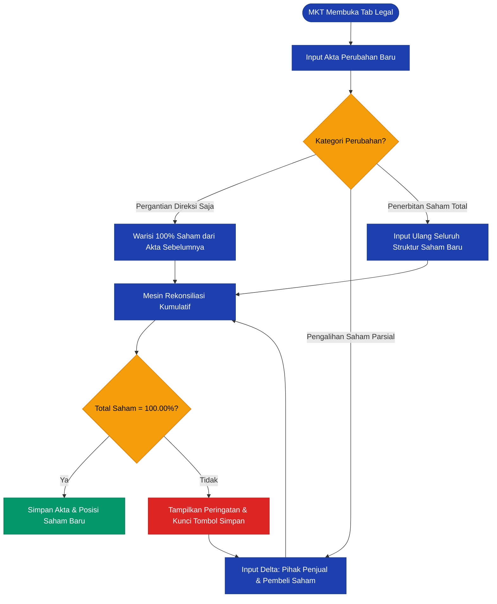
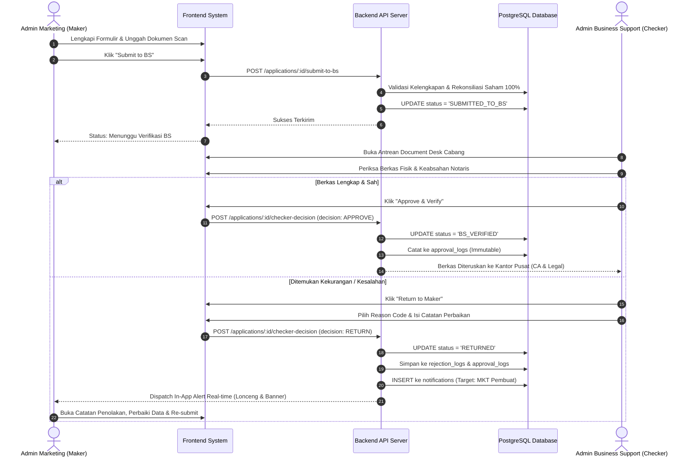

# PRD & SPESIFIKASI BISNIS DETAIL (ENTERPRISE PRODUCT REQUIREMENTS)
## SISTEM ORIGINASI PEMBIAYAAN CAPTIVE LIUGONG (LOS-DMS)
### PT LIUGONG FINANCE INDONESIA (LFI)

**Nomor Dokumen:** LFI/PRD/LOS-DMS/2026/001  
**Versi:** 3.0 (Comprehensive Enterprise Edition)  
**Status:** Approved by CTO & CEO Gates · Ready for Implementation  
**Klasifikasi:** Internal Confidential  
**Author:** Lead Business Architect & Product Manager  
**Reviewer:** Willy (Lead Solution Architect & Product Owner)  

---

## 1. PROBLEM STATEMENT & BUSINESS DRIVERS

### 1.1 Masalah Operasional Saat Ini
1. **Inkonsistensi Akta Notaris vs Struktur Kepemilikan (The Fragmented Deed Problem):**  
   Dalam praktik hukum Indonesia, akta perubahan perseroan (*amendment deed*) sering kali **hanya memuat klausul parsial (Delta Update)**—misalnya hanya mengganti Direktur Utama, atau hanya mencatat transaksi jual-beli 10% saham antara dua pihak. Sistem awal mengasumsikan input akta baru adalah data mandiri terisolasi, sehingga pemegang saham lama yang tidak disebutkan dalam akta baru terhapus secara tidak sengaja, menyebabkan kepemilikan modal menjadi tidak seimbang (< 100%) dan cacat hukum.
2. **Ketiadaan Pemisahan Tugas Formal (No Maker-Checker Protocol):**  
   Pengajuan aplikasi pembiayaan armada bernilai miliaran rupiah tidak memiliki pintu verifikasi cabang yang tegas. Marketing langsung mengunggah berkas tanpa penyaringan awal oleh Business Support (*Branch Operations*), menyebabkan berkas yang belum lengkap atau kadaluwarsa langsung lolos ke Komite Kredit.
3. **Risiko Kerusakan Rekam Jejak Kontrak Otentik (Relational Drift):**  
   Penggunaan Foreign Key murni pada data transaksi pembiayaan (misal model unit excavator LiuGong atau nama cabang) menyebabkan kontrak masa lalu yang berstatus akta otentik ikut berubah namanya ketika master data diubah di kemudian hari.

### 1.2 Dampak Jika Masalah Tidak Diselesaikan (Cost of Inaction)
- Risiko pembatalan perjanjian sewa guna usaha (*financial lease agreement*) di pengadilan perdata akibat sengketa keabsahan susunan pengurus/pemegang saham.
- Sanksi kepatuhan dari OJK atas pelanggaran *Four-Eyes Principle* dan tata kelola teknologi informasi.
- Keterlambatan persetujuan kredit (*turnaround time* membengkak hingga > 14 hari kerja), kalah bersaing dengan kompetitor pembiayaan alat berat lainnya.

---

## 2. GOALS & NON-GOALS

### 2.1 Goals (Spesifik & Terukur)
1. **G-01:** Menerapkan mesin rekonsiliasi kumulatif (*Cumulative Legal Inheritance Engine*) yang secara otomatis mewariskan susunan pemegang saham yang tidak berubah, sehingga posisi hukum selalu utuh dan tervalidasi mutlak **100.00%**.
2. **G-02:** Mengimplementasikan alur **Maker-Checker** cabang yang memisahkan peran **Admin Marketing (Maker)** dan **Admin Business Support (Checker)** lengkap dengan *Reason Code*, feedback penolakan, dan notifikasi real-time ke pembuat berkas.
3. **G-03:** Menerapkan mekanisme **Dual-Column Persistence** (Free-Text Snapshot) pada data aplikasi kredit agar dokumen perjanjian kebal dari perubahan master data di masa depan.
4. **G-04:** Menjamin audit trail bersifat **Immutable (Append-Only)** yang dikunci secara fisik di level database PostgreSQL sesuai regulasi POJK.
5. **G-05:** Memangkas TAT pengajuan repeat order debitur lama (*Existing Customer*) dari 14 hari menjadi **maksimal 3 hari kerja**.

### 2.2 Non-Goals (Out of Scope untuk Rilis Ini)
- **NG-01:** Integrasi payment gateway / autodebet cicilan bank secara real-time (dikelola oleh divisi Treasury secara terpisah).
- **NG-02:** Pembuatan kontrak perjanjian pembiayaan otomatis (*Automated Document Generation via Notary API*) — kontrak fisik tetap dicetak melalui template resmi legal.
- **NG-03:** Penilaian skor kredit otomatis berbasis Machine Learning (penilaian risiko tetap menjadi wewenang Credit Analyst internal).

---

## 3. USER STORIES & ROLES SPECIFICATION

```
┌─────────────────────────────────────────────────────────────────────────────┐
│                            USER PERSONA MATRIX                              │
├─────────────────┬──────────────────────┬────────────────────────────────────┤
│ PERAN           │ AKTOR SISTEM         │ TANGGUNG JAWAB UTAMA               │
├─────────────────┼──────────────────────┼────────────────────────────────────┤
│ Maker           │ Admin Marketing      │ Input nasabah (New/Existing),      │
│                 │ (MKT)                │ unggah akta, input delta saham,    │
│                 │                      │ perbaiki berkas returned, submit.  │
├─────────────────┼──────────────────────┼────────────────────────────────────┤
│ Checker         │ Admin Business       │ Verifikasi keaslian berkas cabang, │
│                 │ Support (BS)         │ cek hasil rekonsiliasi saham 100%, │
│                 │                      │ approve ke Pusat / return ke MKT.  │
├─────────────────┼──────────────────────┼────────────────────────────────────┤
│ Credit Analyst  │ CA (Head Office)     │ Analisis rasio, spreading neraca,  │
│                 │                      │ kapasitas bayar, sign-off CA.      │
├─────────────────┼──────────────────────┼────────────────────────────────────┤
│ Legal Counsel   │ Legal (Head Office)  │ Verifikasi notaris, SK Menkumham,  │
│                 │                      │ legal opinion, sign-off Legal.     │
├─────────────────┼──────────────────────┼────────────────────────────────────┤
│ Approver        │ Credit Committee     │ Keputusan akhir: APPROVE / REJECT. │
└─────────────────┴──────────────────────┴────────────────────────────────────┘
```

### User Stories Utama:
1. **US-01 (Admin MKT - New Customer):**
   *Sebagai Admin Marketing, saya ingin mendaftarkan nasabah baru dengan validasi NPWP dan NIB dari awal, sehingga tidak terjadi duplikasi entitas di database.*
2. **US-02 (Admin MKT - Partial Amendment Deed):**
   *Sebagai Admin Marketing, saya ingin menginput Akta Perubahan yang hanya memuat pergantian Direksi atau pengalihan saham sebagian, tanpa harus mengetik ulang seluruh pemegang saham lama yang tidak berubah, agar proses input cepat dan tidak terjadi kekeliruan data.*
3. **US-03 (Admin BS - Verification & Return):**
   *Sebagai Admin Business Support, saya ingin memeriksa keabsahan akta dan kelengkapan dokumen, dan jika ditemukan kesalahan, saya dapat mengembalikan berkas ke Admin Marketing dengan memilih Reason Code standar dan menyertakan catatan perbaikan detail.*
4. **US-04 (Admin MKT - Notification & Revision):**
   *Sebagai Admin Marketing, saya ingin menerima notifikasi real-time dan melihat badge peringatan saat aplikasi saya dikembalikan oleh BS, lengkap dengan alasan dan link perbaikan langsung.*

---

## 4. PERSYARATAN FUNGSIONAL (FUNCTIONAL REQUIREMENTS - MoSCoW)

| ID | Modul | Deskripsi Persyaratan | Prioritas | Acceptance Criteria |
|:---|:---|:---|:---:|:---|
| **FR-01** | Intake | Pembedaan alur New vs Existing Customer | **P0 (Must)** | New Customer validasi NPWP 16 & NIB 13 digit. Existing Customer menarik profil lama dan menerbitkan nomor FAP baru secara independen. |
| **FR-02** | Legal | Mesin Rekonsiliasi Kumulatif Akta | **P0 (Must)** | Pemegang saham lama yang tidak berubah otomatis diwariskan (`is_inherited = true`). Hasil penggabungan wajib tepat 100.00%. |
| **FR-03** | Workflow | Alur Maker - Checker Cabang | **P0 (Must)** | Hanya role `MKT` yang bisa submit; hanya role `BS` yang bisa approve atau return berkas di tahap cabang. |
| **FR-04** | Workflow | Alasan Penolakan Terstruktur | **P0 (Must)** | Tombol Return oleh BS mewajibkan pemilihan `reason_code` dan pengisian catatan minimal 10 karakter. |
| **FR-05** | Notifikasi | In-App Alert ke Maker | **P0 (Must)** | Saat aplikasi di-return, Admin MKT pembuat menerima notifikasi unread dan badge peringatan visual pada dashboard. |
| **FR-06** | Data Engine | Dual-Column Free-Text Persistence | **P0 (Must)** | Data unit alat berat LiuGong dan profil aplikasi disimpan sebagai teks statis di tabel transaksi. |
| **FR-07** | Keamanan | Immutable Database Audit Trail | **P0 (Must)** | Tabel `approval_logs` dan `rejection_logs` dilindungi trigger yang memblokir instruksi SQL `UPDATE` dan `DELETE`. |
| **FR-08** | Financial | Spreading Neraca & Laba Rugi | **P1 (Should)**| Validasi keseimbangan $\text{Total Aset} \equiv \text{Total Pasiva}$ dan indikator rasio keuangan otomatis. |
| **FR-09** | DMS | Private File Streaming (Signed URL) | **P1 (Should)**| Berkas PDF/gambar disajikan via short-lived token yang hangus dalam 15 menit. |

---

## 5. ALUR PROSES BISNIS & WORKFLOW DIAGRAMS (MERMAID)

### 5.1 Alur Rekonsiliasi Akta & Stakeholders (Cumulative Inheritance)



---

### 5.2 Alur Persetujuan Cabang: Maker - Checker Workflow



---

## 6. MATRIKS REASON CODE & PENANGANAN PENOLAKAN (RETURN MATRIX)

| Kode Alasan | Kategori Masalah | Deskripsi Masalah | Tindakan Perbaikan yang Dituntut dari Maker |
|:---|:---|:---|:---|
| `ERR_LEGAL_DEED_INCOMPLETE` | Dokumen Akta | Halaman akta terpotong atau stempel notaris tidak terbaca. | Unggah ulang hasil scan akta asli secara lengkap dari halaman pertama s.d. tanda tangan para pihak. |
| `ERR_SK_MENKUMHAM_MISSING` | Kemenkumham | Akta perubahan tidak disertai bukti pengesahan AHU Kemenkumham. | Lampirkan salinan SK Menteri Kemenkumham atau Surat Penerimaan Pemberitahuan Perubahan Data Perseroan. |
| `ERR_SHAREHOLDER_MISMATCH` | Saham & Pemilik | Hasil rekonsiliasi saham tidak sesuai dengan pasal peralihan saham pada akta. | Buka tab Legal, sesuaikan persentase kepemilikan pihak terkait hingga mencerminkan isi akta notaris. |
| `ERR_KTP_NPWP_INVALID` | Identitas Pengurus| NIK KTP pengurus tidak 16 digit atau NPWP perusahaan tidak valid. | Periksa kembali nomor identitas kependudukan dan NPWP sesuai kartu fisik nasabah. |
| `ERR_MANDATORY_DOC_EXPIRED` | Dokumen Usaha | Izin operasional / NIB / paspor WNA telah habis masa berlaku. | Minta debitur memperbarui surat izin atau melampirkan surat keterangan perpanjangan resmi. |
| `ERR_UNIT_PRICE_MISMATCH` | Finansial Unit | Harga unit LiuGong pada proposal berbeda dengan Surat Penawaran Resmi (Quotation). | Sesuaikan harga satuan unit pada tab Financing agar sama persis dengan quotation dealer. |
| `ERR_OTHER` | Lain-lain | Catatan operasional khusus cabang. | Ikuti instruksi detail yang dituliskan oleh Checker pada kolom komentar. |

---

## 7. RENCANA TAHAPAN EKSEKUSI & ACCEPTANCE GATES

```
┌─────────────────────────────────────────────────────────────────────────────┐
│ SPRINT 1: REKONSILIASI AKTA & SCHEMA ENGINE                                │
│ • Migrasi tabel legal_deeds & deed_stakeholders                            │
│ • Implementasi algoritma rekonsiliasi kumulatif di server/reconciliation.ts │
│ • Automated test: pewarisan saham dan validasi 100.00%                      │
├─────────────────────────────────────────────────────────────────────────────┤
│ SPRINT 2: MAKER-CHECKER CABANG & NOTIFIKASI REAL-TIME                      │
│ • Implementasi endpoint submit-to-bs & checker-decision                     │
│ • Pembuatan tabel rejection_logs & notifications                           │
│ • Desain modal pengembalian berkas dengan dropdown Reason Code              │
│ • Lencana lonceng notifikasi dan visual alert banner di dashboard MKT       │
├─────────────────────────────────────────────────────────────────────────────┤
│ SPRINT 3: DUAL-COLUMN FREE-TEXT SNAPSHOT & IMMUTABILITY                     │
│ • Penegakan database trigger pengunci audit logs                            │
│ • Persistensi teks statis unit alat berat LiuGong pada tabel aplikasi       │
├─────────────────────────────────────────────────────────────────────────────┤
│ SPRINT 4: INTEGRATION TEST, CABANG PILOT (JKT01 & BPN01) & PRODUCTION       │
│ • Pengujian end-to-end simulasi pengembalian berkas dan re-submission      │
│ • UAT bersama perwakilan Admin Marketing dan Business Support              │
└─────────────────────────────────────────────────────────────────────────────┘
```
