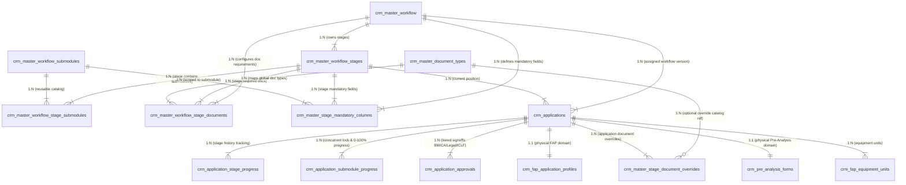

# Arsitektur Database Modular & Dynamic Workflow CRM LiuGong (Next-Gen)
# Arsitektur Database Modular & Dynamic Workflow CRM LiuGong (Next-Gen)
**Dokumen Spesifikasi Desain Database Relasional, Adaptabilitas Workflow Dinamis, Pemetaan Relasi (ERD), Skema Modular, dan Panduan Implementasi**  
*Versi: 3.0 (Final Architecture Blueprint & Review Consolidation) | Tanggal Terbit: 17 November 2026*

---

## 1. Ringkasan Eksekutif & Hasil Review Rombak Workflow

Berdasarkan tinjauan arsitektur sistem dan hasil penyelarasan kebutuhan bisnis CRM Pembiayaan Alat Berat (*heavy equipment financing*), desain workflow mengalami perombakan menyeluruh untuk mencapai modularitas tingkat tinggi, skalabilitas tanpa henti (*zero-DDL workflow mutations*), dan standardisasi model data:

### 1.1 Keputusan Kunci Arsitektur (Architecture Decisions)
1. **Penyederhanaan Tabel Workflow Inti:**
   * Nama tabel utama dibakukan menjadi **`crm_master_workflow`** (sebelumnya `crm_master_workflow_definitions`).
   * Foreign Key pada tabel-tabel turunan disesuaikan menjadi `workflow_id`.
2. **Standardisasi Primary Key & Audit Trail:**
   * Semua tabel workflow menggunakan **`INT AUTO_INCREMENT`** sebagai Physical Primary Key (`id`).
   * Menggunakan kode bisnis unik autogenerated yang distandarkan (misal: `WF-001`, `STG-001`, `SMOD-001`, `DOC-001`, `MAND-001`).
   * Setiap tabel wajib memiliki audit trail lengkap: `created_at DATETIME`, `created_by INT`, `updated_at DATETIME`, dan `updated_by INT`.
3. **Mekanisme Soft Delete:**
   * Kolom **`is_active TINYINT(1) DEFAULT 1`** digunakan untuk *soft delete*.
   * Jika user menghapus workflow/stage di dashboard, sistem melakukan soft delete (`is_active = 0`) sehingga data aplikasi historis yang mengacu ke workflow tersebut tidak *orphan* atau rusak.
4. **Penghapusan Tabel Usang (`crm_master_workflow_transitions`):**
   * Tabel `crm_master_workflow_transitions` resmi **dihapus**.
   * Transisi antar-stage dikendalikan secara deterministik dan dinamis melalui kolom `sequence_number`, mode eksekusi (`execution_mode`), dan aturan kelulusan gerbang (`pass_gate_rule = 'ALL_COMPLETED'`), sehingga menyederhanakan pemeliharaan relasi tanpa tabel graf transisi yang redundan.
5. **Katalog Master Dokumen & Dokumen per Stage:**
   * **`crm_master_document_types`**: Katalog master seluruh jenis dokumen perusahaan secara global (KTP, NPWP, Akta, NIB, Rek Koran, SPK, SLIK OJK, Laporan Keuangan Audited, PO, dll.). Berdiri otonom tanpa ikatan hardcode ke stage tertentu.
   * **`crm_master_workflow_stage_documents`**: Mengatur daftar dokumen persyaratan per stage dengan mereferensikan `document_type_id` (`FK -> crm_master_document_types.id`), menentukan dokumen mana yang *dapat diunggah* (`can_upload`) dan *wajib diunggah* (`is_mandatory`) sebelum stage dinyatakan tuntas. Admin dapat melakukan *manual adjustment* di menu Customize Master Data.
   * **`crm_master_stage_document_overrides`**: Tabel khusus untuk mencatat pengecualian/override dokumen di luar katalog master (misal: dokumen tambahan kondisional atau dokumen yang di-waive oleh Komite Kredit).
6. **Pemecahan Master Kolom Mandatory:**
   * Dibakukan menjadi tabel **`crm_master_stage_mandatory_columns`** (menggantikan nama sebelumnya `stage_mandatory_rules`).
   * Mengikat `workflow_id`, `stage_id`, `submodule_id`, `section_name`, `column_key`, `column_label`, `is_mandatory`, dan `validation_rule` secara dinamis per stage.
7. **Penyusunan Hierarki UI & Metode Deep Clone Otonom:**
   * **Hierarki UI Customize Master Data:** User memilih atau membuat **Workflow** terlebih dahulu, baru kemudian mengonfigurasi **Stages**, **Submodules**, **Stage Documents**, dan **Mandatory Columns**.
   * **Deep Clone:** Fitur duplikasi workflow yang menyalin seluruh hierarki (workflow record, stages, stage_submodules mapping, stage_documents, stage_mandatory_columns) secara otonom menghasilkan record independen baru tanpa keterikatan kunci parent (*pure deep copy*).

---

## 2. Diagram Relasional & Kardinalitas (Entity-Relationship Diagram)



---

## 3. Matriks Relasi Antar-Tabel (Parent-Child Matrix)

| Tabel Induk (Parent) | PK | Tabel Anak (Child) | FK | Kardinalitas | Aturan Integritas | Peran & Alur Data |
| :--- | :---: | :--- | :---: | :---: | :--- | :--- |
| `crm_master_workflow` | `id` | `crm_master_workflow_stages` | `workflow_id` | **1 : N** | `CASCADE / CASCADE` | Menampung tahapan gerbang yang dimiliki oleh skema workflow. |
| `crm_master_workflow_stages` | `id` | `crm_master_workflow_stage_submodules` | `stage_id` | **1 : N** | `CASCADE / CASCADE` | Menentukan submodul yang bernaung di bawah tahapan gerbang tertentu. |
| `crm_master_workflow_submodules` | `id` | `crm_master_workflow_stage_submodules` | `submodule_id` | **1 : N** | `RESTRICT / CASCADE` | Tabel pivot otonom: Mengaitkan modul formulir ke tahapan mana pun secara decoupled. |
| `crm_master_document_types` | `id` | `crm_master_workflow_stage_documents` | `document_type_id` | **1 : N** | `RESTRICT / CASCADE` | Mengambil jenis dokumen dari katalog master global untuk diwajibkan di stage. |
| `crm_master_document_types` | `id` | `crm_master_stage_document_overrides` | `document_type_id` | **1 : N** | `SET NULL / CASCADE` | Menunjuk jenis dokumen katalog master jika override berupa penyesuaian dokumen standar. |
| `crm_master_workflow_stages` | `id` | `crm_master_workflow_stage_documents` | `stage_id` | **1 : N** | `CASCADE / CASCADE` | Menentukan dokumen yang wajib atau dapat diunggah pada tahapan bersangkutan. |
| `crm_master_workflow_stages` | `id` | `crm_master_stage_mandatory_columns` | `stage_id` | **1 : N** | `CASCADE / CASCADE` | Menentukan kolom input mandatory spesifik per stage dan submodule. |
| `crm_master_workflow` | `id` | `crm_applications` | `workflow_id` | **1 : N** | `RESTRICT / CASCADE` | Mengikat pengajuan aplikasi ke versi workflow aktif saat berkas dibuat. |
| `crm_master_workflow_stages` | `id` | `crm_applications` | `current_stage_id` | **1 : N** | `RESTRICT / CASCADE` | Menunjukkan stage posisi real-time aplikasi di dalam pipa pembiayaan. |
| `crm_applications` | `id` | `crm_master_stage_document_overrides` | `application_id` | **1 : N** | `CASCADE / CASCADE` | Menyimpan dokumen non-standar, dokumen tambahan, atau dispensasi waive. |
| `crm_applications` | `id` | `crm_application_stage_progress` | `application_id` | **1 : N** | `CASCADE / CASCADE` | Rekam jejak status historis pergerakan stage yang dilewati aplikasi. |
| `crm_applications` | `id` | `crm_application_submodule_progress` | `application_id` | **1 : N** | `CASCADE / CASCADE` | Melacak progress 0-100%, editor aktif, dan optimistic lock pengerjaan simultan. |
| `crm_applications` | `id` | `crm_application_approvals` | `application_id` | **1 : N** | `CASCADE / CASCADE` | Menyimpan risalah persetujuan berjenjang (BM, CA, Legal, Komite ICLF). |
| `crm_applications` | `id` | `crm_fap_application_profiles` | `application_id` | **1 : 1** | `CASCADE / CASCADE` | Domain fisik transaksi FAP: profil debitur, DP, tenor, bunga. |
| `crm_applications` | `id` | `crm_pre_analysis_forms` | `application_id` | **1 : 1** | `CASCADE / CASCADE` | Domain fisik transaksi Pre-Analysis: bowheer, proyek, SLIK OJK. |

---

## 4. Skema DDL SQL Fisik Terstandarisasi

Berikut adalah spesifikasi DDL SQL lengkap dengan `INT AUTO_INCREMENT` PK, kode bisnis unik, soft-delete, dan audit trail:

```sql
-- =============================================================================
-- 1. MASTER WORKFLOW UTAMA (Pengganti crm_master_workflow_definitions)
-- =============================================================================
CREATE TABLE `crm_master_workflow` (
  `id` INT AUTO_INCREMENT NOT NULL,
  `workflow_code` VARCHAR(50) NOT NULL,
  `workflow_name` VARCHAR(150) NOT NULL,
  `version` INT NOT NULL DEFAULT 1,
  `description` TEXT NULL,
  `is_default` TINYINT(1) NOT NULL DEFAULT 0,
  `is_active` TINYINT(1) NOT NULL DEFAULT 1 COMMENT '1=Active, 0=Soft Deleted from Dashboard',
  `created_by` INT NOT NULL DEFAULT 1,
  `created_at` DATETIME NOT NULL DEFAULT CURRENT_TIMESTAMP,
  `updated_by` INT NULL,
  `updated_at` DATETIME NOT NULL DEFAULT CURRENT_TIMESTAMP ON UPDATE CURRENT_TIMESTAMP,
  PRIMARY KEY (`id`),
  UNIQUE KEY `uk_workflow_code` (`workflow_code`),
  KEY `idx_wf_is_default_active` (`is_default`, `is_active`)
) ENGINE=InnoDB DEFAULT CHARSET=utf8mb4;

-- =============================================================================
-- 2. MASTER WORKFLOW STAGES (Tahapan Gerbang Alur)
-- =============================================================================
CREATE TABLE `crm_master_workflow_stages` (
  `id` INT AUTO_INCREMENT NOT NULL,
  `workflow_id` INT NOT NULL,
  `stage_code` VARCHAR(50) NOT NULL,
  `stage_name` VARCHAR(150) NOT NULL,
  `sequence_number` INT NOT NULL DEFAULT 1,
  `execution_mode` ENUM('PARALLEL', 'SEQUENTIAL') NOT NULL DEFAULT 'SEQUENTIAL',
  `pass_gate_rule` ENUM('ALL_COMPLETED', 'ANY_COMPLETED') NOT NULL DEFAULT 'ALL_COMPLETED',
  `required_approval_role` VARCHAR(50) NULL,
  `sla_days` INT NOT NULL DEFAULT 3,
  `is_active` TINYINT(1) NOT NULL DEFAULT 1 COMMENT '1=Active, 0=Soft Deleted',
  `created_by` INT NOT NULL DEFAULT 1,
  `created_at` DATETIME NOT NULL DEFAULT CURRENT_TIMESTAMP,
  `updated_by` INT NULL,
  `updated_at` DATETIME NOT NULL DEFAULT CURRENT_TIMESTAMP ON UPDATE CURRENT_TIMESTAMP,
  PRIMARY KEY (`id`),
  UNIQUE KEY `uk_stage_code_workflow` (`workflow_id`, `stage_code`),
  KEY `idx_wf_stages_seq` (`workflow_id`, `sequence_number`),
  CONSTRAINT `fk_wf_stages_workflow` FOREIGN KEY (`workflow_id`) 
    REFERENCES `crm_master_workflow` (`id`) ON DELETE CASCADE ON UPDATE CASCADE
) ENGINE=InnoDB DEFAULT CHARSET=utf8mb4;

-- =============================================================================
-- 3. MASTER WORKFLOW SUBMODULES (Katalog Formulir Bisnis Otonom)
-- =============================================================================
CREATE TABLE `crm_master_workflow_submodules` (
  `id` INT AUTO_INCREMENT NOT NULL,
  `submodule_code` VARCHAR(50) NOT NULL,
  `submodule_name` VARCHAR(150) NOT NULL,
  `domain_category` VARCHAR(50) NOT NULL DEFAULT 'MARKETING',
  `target_tables` VARCHAR(255) NOT NULL,
  `ui_route_path` VARCHAR(150) NOT NULL,
  `is_active` TINYINT(1) NOT NULL DEFAULT 1 COMMENT '1=Active, 0=Soft Deleted',
  `created_by` INT NOT NULL DEFAULT 1,
  `created_at` DATETIME NOT NULL DEFAULT CURRENT_TIMESTAMP,
  `updated_by` INT NULL,
  `updated_at` DATETIME NOT NULL DEFAULT CURRENT_TIMESTAMP ON UPDATE CURRENT_TIMESTAMP,
  PRIMARY KEY (`id`),
  UNIQUE KEY `uk_submodule_code` (`submodule_code`)
) ENGINE=InnoDB DEFAULT CHARSET=utf8mb4;

-- =============================================================================
-- 4. PIVOT STAGE SUBMODULES (Decoupling Pivot Key)
-- =============================================================================
CREATE TABLE `crm_master_workflow_stage_submodules` (
  `id` INT AUTO_INCREMENT NOT NULL,
  `stage_id` INT NOT NULL,
  `submodule_id` INT NOT NULL,
  `order_in_stage` INT NOT NULL DEFAULT 1,
  `is_mandatory` TINYINT(1) NOT NULL DEFAULT 1,
  `allow_concurrent_edit` TINYINT(1) NOT NULL DEFAULT 1,
  `is_active` TINYINT(1) NOT NULL DEFAULT 1 COMMENT '1=Active, 0=Soft Deleted',
  `created_by` INT NOT NULL DEFAULT 1,
  `created_at` DATETIME NOT NULL DEFAULT CURRENT_TIMESTAMP,
  `updated_by` INT NULL,
  `updated_at` DATETIME NOT NULL DEFAULT CURRENT_TIMESTAMP ON UPDATE CURRENT_TIMESTAMP,
  PRIMARY KEY (`id`),
  UNIQUE KEY `uk_stage_submod` (`stage_id`, `submodule_id`),
  CONSTRAINT `fk_stage_submod_stage` FOREIGN KEY (`stage_id`) 
    REFERENCES `crm_master_workflow_stages` (`id`) ON DELETE CASCADE ON UPDATE CASCADE,
  CONSTRAINT `fk_stage_submod_sub` FOREIGN KEY (`submodule_id`) 
    REFERENCES `crm_master_workflow_submodules` (`id`) ON UPDATE CASCADE
) ENGINE=InnoDB DEFAULT CHARSET=utf8mb4;

-- =============================================================================
-- 5. MASTER DOCUMENT TYPES CATALOG (Katalog Induk Master Jenis Dokumen Global)
-- =============================================================================
CREATE TABLE `crm_master_document_types` (
  `id` INT AUTO_INCREMENT NOT NULL,
  `code` VARCHAR(50) NOT NULL,
  `name` VARCHAR(150) NOT NULL,
  `document_category` VARCHAR(50) NOT NULL DEFAULT 'LEGAL',
  `department_code` VARCHAR(30) NOT NULL DEFAULT 'ALL',
  `description` TEXT NULL,
  `allowed_file_types` VARCHAR(100) NOT NULL DEFAULT 'pdf,jpg,jpeg,png',
  `max_file_size_mb` INT NOT NULL DEFAULT 10,
  `is_active` TINYINT(1) NOT NULL DEFAULT 1 COMMENT '1=Active, 0=Soft Deleted',
  `created_by` INT NOT NULL DEFAULT 1,
  `created_at` DATETIME NOT NULL DEFAULT CURRENT_TIMESTAMP,
  `updated_by` INT NULL,
  `updated_at` DATETIME NOT NULL DEFAULT CURRENT_TIMESTAMP ON UPDATE CURRENT_TIMESTAMP,
  PRIMARY KEY (`id`),
  UNIQUE KEY `uk_doc_type_code` (`code`)
) ENGINE=InnoDB DEFAULT CHARSET=utf8mb4;

-- =============================================================================
-- 6. MASTER WORKFLOW STAGE DOCUMENTS (Daftar Persyaratan Dokumen per Stage)
-- =============================================================================
CREATE TABLE `crm_master_workflow_stage_documents` (
  `id` INT AUTO_INCREMENT NOT NULL,
  `workflow_id` INT NOT NULL,
  `stage_id` INT NOT NULL,
  `document_type_id` INT NOT NULL,
  `can_upload` TINYINT(1) NOT NULL DEFAULT 1,
  `is_mandatory` TINYINT(1) NOT NULL DEFAULT 1,
  `is_active` TINYINT(1) NOT NULL DEFAULT 1 COMMENT '1=Active, 0=Soft Deleted',
  `created_by` INT NOT NULL DEFAULT 1,
  `created_at` DATETIME NOT NULL DEFAULT CURRENT_TIMESTAMP,
  `updated_by` INT NULL,
  `updated_at` DATETIME NOT NULL DEFAULT CURRENT_TIMESTAMP ON UPDATE CURRENT_TIMESTAMP,
  PRIMARY KEY (`id`),
  UNIQUE KEY `uk_wf_stg_doc` (`workflow_id`, `stage_id`, `document_type_id`),
  KEY `idx_stg_doc_stage` (`stage_id`),
  KEY `idx_stg_doc_type` (`document_type_id`),
  CONSTRAINT `fk_stg_doc_workflow` FOREIGN KEY (`workflow_id`)
    REFERENCES `crm_master_workflow` (`id`) ON DELETE CASCADE ON UPDATE CASCADE,
  CONSTRAINT `fk_stg_doc_stage` FOREIGN KEY (`stage_id`) 
    REFERENCES `crm_master_workflow_stages` (`id`) ON DELETE CASCADE ON UPDATE CASCADE,
  CONSTRAINT `fk_stg_doc_type` FOREIGN KEY (`document_type_id`)
    REFERENCES `crm_master_document_types` (`id`) ON UPDATE CASCADE
) ENGINE=InnoDB DEFAULT CHARSET=utf8mb4;

-- =============================================================================
-- 7. DOCUMENT OVERRIDES (Pengecualian / Tambahan Dokumen Non-Master)
-- =============================================================================
CREATE TABLE `crm_master_stage_document_overrides` (
  `id` INT AUTO_INCREMENT NOT NULL,
  `application_id` INT NOT NULL,
  `stage_id` INT NOT NULL,
  `document_type_id` INT NULL,
  `custom_document_name` VARCHAR(150) NULL,
  `override_type` ENUM('ADD_MANDATORY', 'ADD_OPTIONAL', 'WAIVED') NOT NULL DEFAULT 'ADD_MANDATORY',
  `reason` TEXT NOT NULL,
  `requested_by` INT NOT NULL,
  `is_active` TINYINT(1) NOT NULL DEFAULT 1,
  `created_by` INT NOT NULL DEFAULT 1,
  `created_at` DATETIME NOT NULL DEFAULT CURRENT_TIMESTAMP,
  `updated_by` INT NULL,
  `updated_at` DATETIME NOT NULL DEFAULT CURRENT_TIMESTAMP ON UPDATE CURRENT_TIMESTAMP,
  PRIMARY KEY (`id`),
  KEY `idx_doc_override_app` (`application_id`),
  KEY `idx_doc_override_type` (`document_type_id`),
  CONSTRAINT `fk_doc_override_app` FOREIGN KEY (`application_id`) 
    REFERENCES `crm_applications` (`id`) ON DELETE CASCADE ON UPDATE CASCADE,
  CONSTRAINT `fk_doc_override_stage` FOREIGN KEY (`stage_id`) 
    REFERENCES `crm_master_workflow_stages` (`id`) ON UPDATE CASCADE,
  CONSTRAINT `fk_doc_override_type` FOREIGN KEY (`document_type_id`) 
    REFERENCES `crm_master_document_types` (`id`) ON DELETE SET NULL ON UPDATE CASCADE
) ENGINE=InnoDB DEFAULT CHARSET=utf8mb4;

-- =============================================================================
-- 8. MASTER STAGE MANDATORY COLUMNS (Validasi Kolom Input Dinamis per Stage)
-- =============================================================================
CREATE TABLE `crm_master_stage_mandatory_columns` (
  `id` INT AUTO_INCREMENT NOT NULL,
  `stage_id` INT NOT NULL,
  `submodule_id` INT NOT NULL,
  `section_name` VARCHAR(100) NOT NULL,
  `column_key` VARCHAR(100) NOT NULL,
  `column_label` VARCHAR(150) NOT NULL,
  `is_mandatory` TINYINT(1) NOT NULL DEFAULT 1,
  `validation_rule` VARCHAR(255) NULL,
  `is_active` TINYINT(1) NOT NULL DEFAULT 1 COMMENT '1=Active, 0=Soft Deleted',
  `created_by` INT NOT NULL DEFAULT 1,
  `created_at` DATETIME NOT NULL DEFAULT CURRENT_TIMESTAMP,
  `updated_by` INT NULL,
  `updated_at` DATETIME NOT NULL DEFAULT CURRENT_TIMESTAMP ON UPDATE CURRENT_TIMESTAMP,
  PRIMARY KEY (`id`),
  UNIQUE KEY `uk_stg_submod_col` (`stage_id`, `submodule_id`, `column_key`),
  CONSTRAINT `fk_stg_mand_stage` FOREIGN KEY (`stage_id`) 
    REFERENCES `crm_master_workflow_stages` (`id`) ON DELETE CASCADE ON UPDATE CASCADE,
  CONSTRAINT `fk_stg_mand_sub` FOREIGN KEY (`submodule_id`) 
    REFERENCES `crm_master_workflow_submodules` (`id`) ON UPDATE CASCADE
) ENGINE=InnoDB DEFAULT CHARSET=utf8mb4;
```

---

## 5. Dampak pada Tabel Eksisting (`crm_applications` & Lainnya)

Ketika tabel workflow modular ini diimplementasikan di database nantinya, perubahan kolom pada tabel eksisting adalah sebagai berikut:

### 5.1 Perubahan pada `crm_applications`
```sql
ALTER TABLE `crm_applications`
  ADD COLUMN `workflow_id` INT NOT NULL DEFAULT 1 AFTER `customer_id`,
  ADD COLUMN `current_stage_id` INT NOT NULL DEFAULT 1 AFTER `workflow_id`,
  ADD CONSTRAINT `fk_app_workflow` FOREIGN KEY (`workflow_id`) REFERENCES `crm_master_workflow` (`id`) ON UPDATE CASCADE,
  ADD CONSTRAINT `fk_app_curr_stage` FOREIGN KEY (`current_stage_id`) REFERENCES `crm_master_workflow_stages` (`id`) ON UPDATE CASCADE;
```
* **Logika Pembuatan Aplikasi Baru:**
  Saat user membuat aplikasi baru dari dashboard (Create Application):
  1. Sistem melakukan lookup workflow default:  
     `SELECT id FROM crm_master_workflow WHERE is_default = 1 AND is_active = 1 LIMIT 1;`
  2. Sistem menetapkan stage awal di urutan pertama:  
     `SELECT id FROM crm_master_workflow_stages WHERE workflow_id = :workflow_id AND sequence_number = 1 AND is_active = 1 LIMIT 1;`
  3. Aplikasi tersimpan dengan referensi `workflow_id` dan `current_stage_id` tersebut.

### 5.2 Hubungan dengan `crm_application_document_files`
* Dokumen fisik yang diunggah (`crm_application_document_files`) menunjuk ke `application_id` dan `document_code`.
* Validasi kelengkapan dokumen pada saat tombol *"Submit Stage"* ditekan mencocokkan:
  1. Dokumen wajib dari `crm_master_workflow_stage_documents` (`is_mandatory = 1`).
  2. Ditambah dokumen tambahan dari `crm_master_stage_document_overrides` (`override_type = 'ADDITIONAL_REQUIRED'`).
  3. Dikurangi dokumen yang di-waive (`override_type = 'WAIVED'`).

---

## 6. Prosedur Deep Clone Workflow Otonom (Zero Dependency)

Ketika admin ingin menduplikasi sebuah alur kerja (misalnya membuat variasi *Mining Fast-Track* dari alur *Standard Financing*), sistem mengeksekusi metode **Deep Clone** berikut:

```sql
-- 1. Clone Record Header Workflow
INSERT INTO crm_master_workflow (workflow_code, workflow_name, version, description, is_default, is_active, created_by)
SELECT 'WF-CLONE-002', CONCAT(workflow_name, ' (Copy)'), 1, description, 0, 1, 1
FROM crm_master_workflow WHERE id = @source_wf_id;
SET @new_wf_id = LAST_INSERT_ID();

-- 2. Clone Stages yang Berasosiasi
-- (Menggunakan cursor / batch insert pada stored procedure / service backend untuk memetakan @old_stage_id ke @new_stage_id)

-- 3. Clone Stage Submodules Pivot (menggunakan @new_stage_id dan submodule_id yang sama)
-- 4. Clone Stage Documents (menggunakan @new_stage_id)
-- 5. Clone Stage Mandatory Columns (menggunakan @new_stage_id dan submodule_id yang sama)
```
* **Hasil:** Workflow baru memiliki ID fisik sendiri, tahapan sendiri, aturan dokumen sendiri, dan kolom mandatory sendiri. Perubahan pada workflow hasil kloning **tidak akan memengaruhi** workflow sumber.

---

## 7. Hierarki UI Customize Master Data

Dashboard admin pada tab Master Data dirancang dengan hierarki 2 tingkat (*2-Tier Configuration Flow*):

```
┌────────────────────────────────────────────────────────────────────────┐
│  STEP 1: SELECT OR CREATE WORKFLOW                                      │
│  [ Standard Financing (WF-001) ▼ ]  [ + New Workflow ]  [ ❐ Clone ]     │
│  Status: Active | Default: Yes | Stages: 2                             │
└───────────────────────────────────┬────────────────────────────────────┘
                                    │ Activates context
                                    ▼
┌────────────────────────────────────────────────────────────────────────┐
│  STEP 2: CONFIGURE STAGES, SUBMODULES, DOCUMENTS & MANDATORY COLUMNS    │
├────────────────────────────────┬───────────────────────────────────────┤
│  STAGES IN THIS WORKFLOW       │  STAGE DETAILS & MAPPINGS             │
│  ├─ 1. MKT_STAGE (PARALLEL)    │  • Execution Mode: PARALLEL           │
│  │   ├─ Submod: FAP Profiling  │  • Pass Gate: ALL_COMPLETED           │
│  │   └─ Submod: Pre-Analysis   │  • Submodules: [FAP Profiling, Pre-An]│
│  │                             │  • Stage Docs: 6 Required, 2 Optional │
│  └─ 2. ICLF_STAGE (SEQUENTIAL) │  • Mandatory Columns: 11 Fields       │
│      ├─ Submod: Credit Memo    │                                       │
│      └─ Submod: Legal Opinion  │  [ Edit Stage ] [ + Add Submodule ]   │
└────────────────────────────────┴───────────────────────────────────────┘
```

---

## 8. Berkas Desain Terkait dalam Repositori

1. **Workbook Excel Lengkap (10 Sheet Terstruktur):**
   * [`CRM_Modular_Database_Design_v2.xlsx`](file:///c:/Users/reage/Documents/ChatGPT/testlfidash/prototype-src/storage/CRM_Modular_Database_Design_v2.xlsx) *(Atau `CRM_Modular_Database_Design_v2_new.xlsx` jika file sedang dibuka).*
   * [`CRM_Modular_Database_Design.xlsx`](file:///c:/Users/reage/Documents/ChatGPT/testlfidash/prototype-src/storage/CRM_Modular_Database_Design.xlsx)
   * **Daftar 10 Sheet:**
     1. `00_Executive_Summary`
     2. `01_Relational_Schema_DDL` (DDL lengkap 7 tabel engine workflow)
     3. `02_Relational_Mapping_Matrix` (Matriks relasi Parent-Child, FK, Kardinalitas)
     4. `03_Workflow_Adaptability` (Showcase mutasi alur tanpa DDL alter)
     5. `04_Workflow_Application` (Siklus hidup aplikasi simultan fork-join)
     6. `05_Workflow_Approval` (Matriks wewenang berjenjang G1-G6)
     7. `06_Roles_Authorities_Matrix` (RBAC matrix 6 peran)
     8. `07_Master_Tables_Dictionary` (Kamus data lengkap master data)
     9. `08_Deep_Clone_&_Overrides` (Mekanisme deep clone dan penanganan dokumen override)
     10. `09_End_to_End_Simulation` (Simulasi 9 langkah pembiayaan PT Dharma Mineral Perkasa)

2. **Dokumen Spesifikasi Teknis Markdown:**
   * [`CRM_Modular_Database_Design.md`](file:///c:/Users/reage/Documents/ChatGPT/testlfidash/prototype-src/storage/CRM_Modular_Database_Design.md)
